# 🍅 Tomato Leaf Doctor — Plant Disease Detection with MobileNetV2

[](https://huggingface.co/spaces/ashwaanthh/tomato-leaf-doctor)
[](https://colab.research.google.com/github/rabbive/plant-disease-detection/blob/main/plant_disease_results.ipynb)
[](LICENSE)

Take a photo of one tomato leaf and get the likely disease, a heatmap
of where the model looked, and what to do about it. A MobileNetV2
network, fine-tuned on 18,160 PlantVillage images, classifies 10
tomato classes (9 diseases + healthy) with **91.33% accuracy on 2,734
held-out test images**. Three safety rules on top keep it from
calling sick leaves healthy or diagnosing photos that aren't leaves.

### ▶ Try it: **[huggingface.co/spaces/ashwaanthh/tomato-leaf-doctor](https://huggingface.co/spaces/ashwaanthh/tomato-leaf-doctor)**

Works on phones and laptops. The model runs inside your browser, so
your photo is never uploaded anywhere.

<p align="center">
  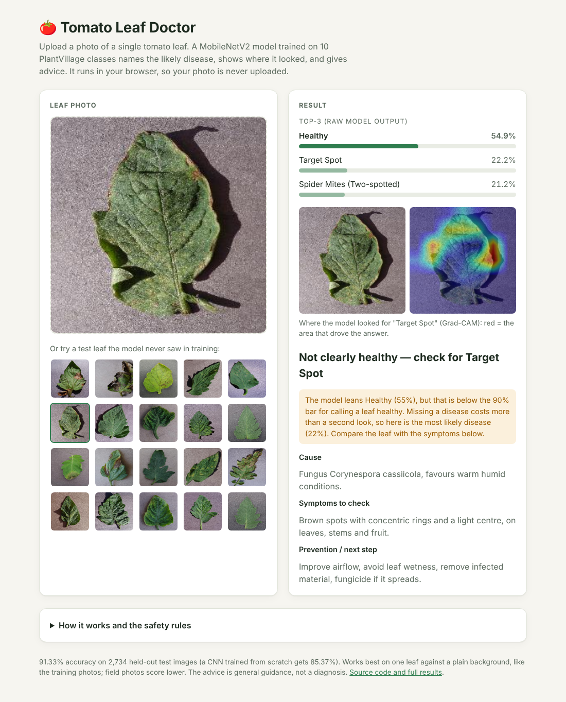
</p>

> **Every number in this README comes from the reference training run
> committed in `outputs/`** (raw PlantVillage tomato images, seed 123).
> Nothing is copied from another source.

---

## Contents

1. [The problem and the 10 classes](#1-the-problem-and-the-10-classes)
2. [System overview (flowcharts)](#2-system-overview)
3. [Dataset](#3-dataset)
4. [Model and training](#4-model-and-training)
5. [Results](#5-results)
6. [Explainability (Grad-CAM)](#6-explainability-grad-cam)
7. [Safety rules](#7-safety-rules)
8. [The demo apps](#8-the-demo-apps)
9. [Quickstart](#9-quickstart)
10. [Repo structure and output files](#10-repo-structure-and-output-files)
11. [Limitations](#11-limitations)
12. [Credits](#12-credits)

---

## 1. The problem and the 10 classes

Leaf diseases can wipe out a tomato crop, and spotting them early
usually needs an expert. The goal: **one leaf photo → disease name +
what to do, in about a second, on any phone.**

Full PlantVillage has 54,305 images of 38 classes across 14 crops. This
project deliberately builds a **crop-specific system**: all 10 tomato
classes (~18,000 images). That trains in about 25–30 minutes on a free
Colab GPU and still covers the full pipeline end to end.

| # | Class | Caused by |
|---|-------|-----------|
| 1 | Healthy | — |
| 2 | Bacterial spot | Bacteria (*Xanthomonas*) |
| 3 | Early blight | Fungus (*Alternaria solani*) |
| 4 | Late blight | Oomycete (*Phytophthora infestans*) |
| 5 | Leaf mold | Fungus (*Passalora fulva*) |
| 6 | Septoria leaf spot | Fungus (*Septoria lycopersici*) |
| 7 | Spider mites | Pest (*Tetranychus urticae*) |
| 8 | Target spot | Fungus (*Corynespora cassiicola*) |
| 9 | Tomato mosaic virus | Virus (ToMV) |
| 10 | Tomato yellow leaf curl virus | Virus (TYLCV, carried by whiteflies) |

---

## 2. System overview

### 2.1 End to end: from photo to advice

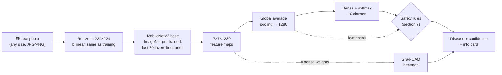

### 2.2 Training pipeline

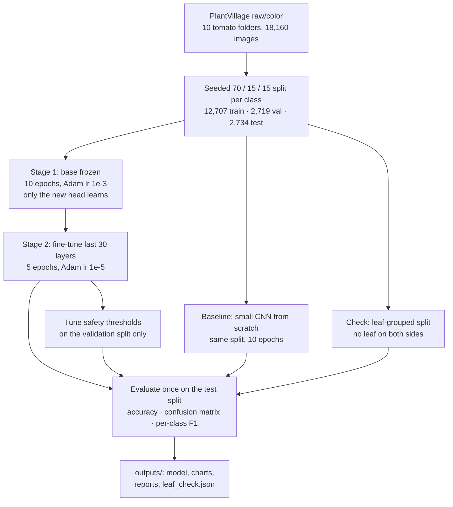

### 2.3 How the app decides what to show

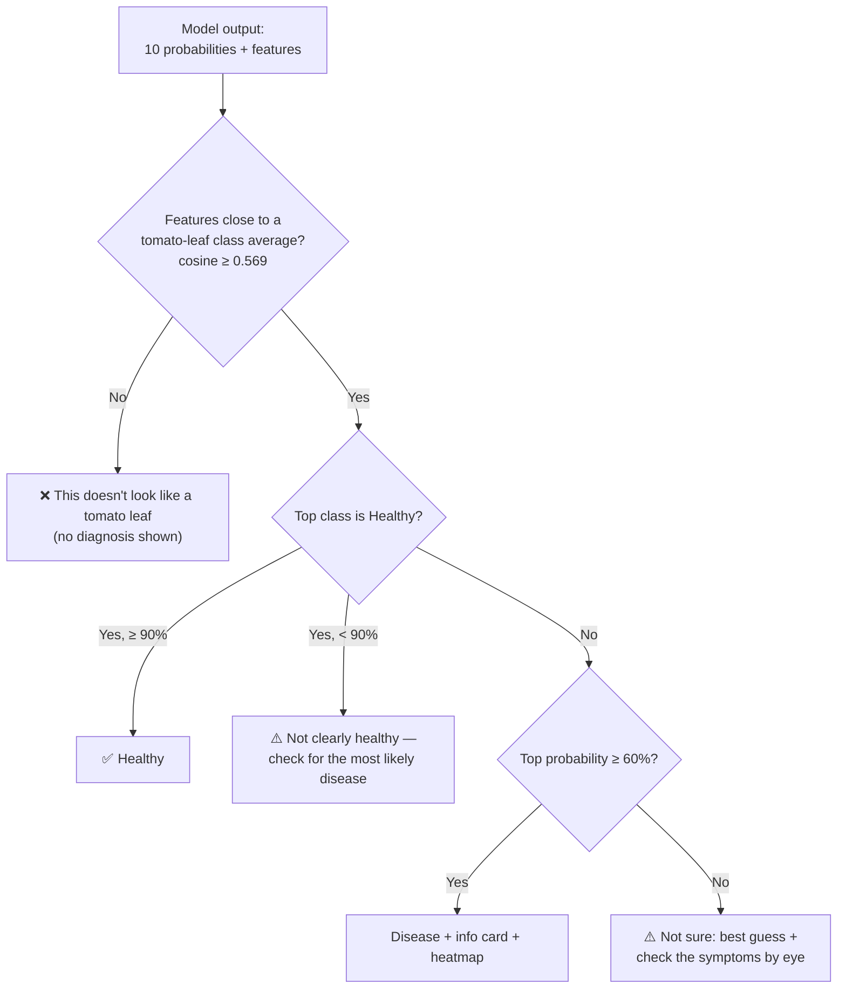

### 2.4 Where it runs

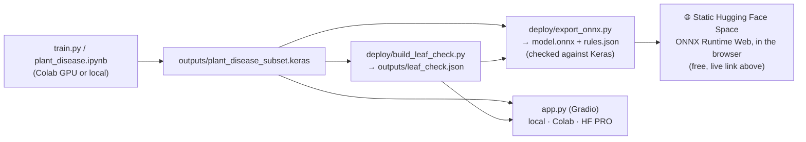

The live Space is a static page (`deploy/static/index.html`) because
Hugging Face only runs Gradio apps on PRO accounts. It runs the same
model in the browser, with the same resize, safety rules and heatmap
as `app.py`: on all 20 sample leaves the two give identical answers,
to four decimal places.

---

## 3. Dataset

**PlantVillage** (Hughes & Salathé; Mohanty et al. 2016): lab photos of
single leaves on plain backgrounds. We use all 10 tomato folders from
`raw/color`, split **70 / 15 / 15 per class** with a fixed seed. Train
is for learning, validation for choosing epochs and thresholds, and test
is touched once, at the end.

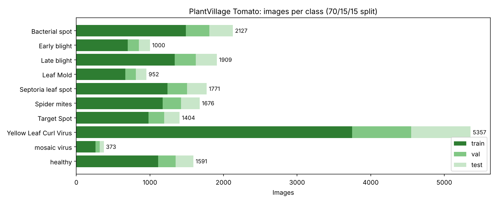

The classes are **imbalanced**: Yellow Leaf Curl Virus has 5,357 images,
mosaic virus only 373. That's why the results report per-class
precision, recall and F1, not just overall accuracy.

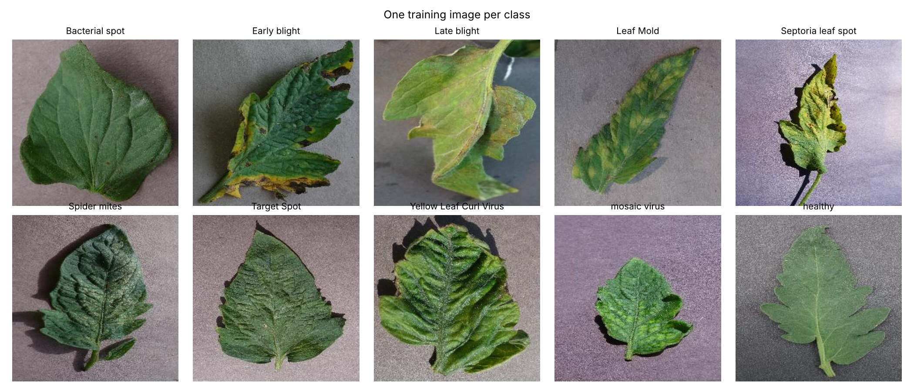

Some diseases look alike to the eye: early blight, target spot and
Septoria all cause brown spots. Section 5 shows that's exactly where
the model struggles.

---

## 4. Model and training

**Transfer learning with MobileNetV2.** The network was pre-trained on
1.2 M ImageNet photos, so it already detects edges, textures and
shapes. We replace its classifier with a new head and teach it leaves.

```
input 224×224×3 (raw 0–255)
 → data augmentation (random flip, ±10% rotation, ±10% zoom — training only)
 → MobileNetV2 preprocessing (scale to −1…1)
 → MobileNetV2 base            (7×7×1280 feature maps)
 → GlobalAveragePooling2D      (1280)
 → Dropout 0.2
 → Dense 10 + softmax
```

2,270,794 parameters in total; only 12,810 (the new head) train in
stage 1. MobileNetV2 is small and fast enough to run on a phone, which
is what makes the in-browser demo possible.

**Two-stage training.** First train only the head with the base frozen.
A randomly initialised head would otherwise send large, noisy gradients
into the pre-trained layers. Then unfreeze the last 30 layers and
fine-tune gently with a 100× smaller learning rate.

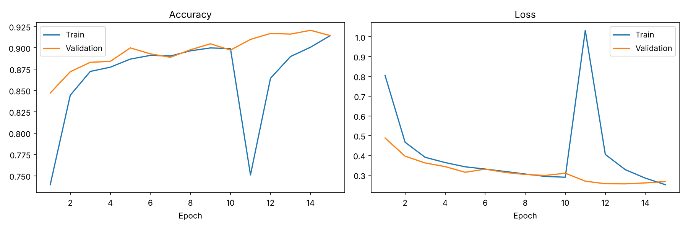

- **Validation accuracy climbs 84.7% → 89.7% (frozen) → 91.4%
  (fine-tuned)**, peaking at 92.1%.
- Train and validation stay close, so there's little overfitting.
- **The dip at epoch 11** is where fine-tuning starts: 30 layers are
  unfrozen and training accuracy drops for one epoch while BatchNorm
  and the newly trainable weights adjust. Validation accuracy keeps
  rising straight through it.

---

## 5. Results

### 5.1 Transfer learning vs. training from scratch

| Model | Parameters | Test accuracy (2,734 images) |
|-------|-----------:|-----------------------------:|
| **MobileNetV2, transfer learning** | 2,270,794 | **91.33%** |
| Small CNN from scratch (3 conv layers) | 94,538 | 85.37% |

Same data, same split. The **+6-point gap is what ImageNet pre-training
buys**. To be fair to the baseline, it's 24× smaller and was still
improving at epoch 10 (validation 87.2%), so more epochs would narrow
the gap.

### 5.2 Confusion matrix (MobileNetV2, test set)

Rows are the true class, columns the prediction. The diagonal is correct.

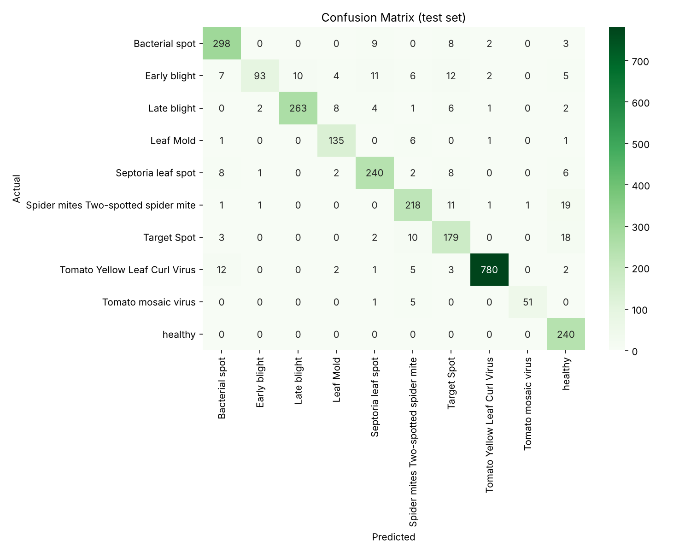

| Class | Precision | Recall | F1 | Test images |
|-------|----------:|-------:|---:|------------:|
| Bacterial spot | 0.90 | 0.93 | 0.92 | 320 |
| Early blight | 0.96 | **0.62** | 0.75 | 150 |
| Late blight | 0.96 | 0.92 | 0.94 | 287 |
| Leaf mold | 0.89 | 0.94 | 0.92 | 144 |
| Septoria leaf spot | 0.90 | 0.90 | 0.90 | 267 |
| Spider mites | 0.86 | 0.87 | 0.86 | 252 |
| Target spot | 0.79 | 0.84 | 0.82 | 212 |
| Yellow leaf curl virus | 0.99 | 0.97 | **0.98** | 805 |
| Mosaic virus | 0.98 | 0.89 | 0.94 | 57 |
| Healthy | **0.81** | 1.00 | 0.90 | 240 |
| **Overall accuracy** | | | **0.91** | 2,734 |

- **Best:** Yellow Leaf Curl Virus (F1 0.98): its curled, yellowed
  leaves look like nothing else, and it has the most training images.
- **Weakest: Early blight, recall 0.62.** Its errors spread over target
  spot (12), Septoria (11) and late blight (10), all brown-spot
  diseases that look alike, and it's one of the smaller classes.
- **Healthy precision 0.81:** no healthy leaf is ever misclassified
  (240/240), but 19 spider-mite and 18 target-spot leaves were called
  healthy, because early symptoms are subtle. That is the costliest
  mistake (nothing gets treated), which is what the first safety rule
  in section 7 fixes.

### 5.3 Baseline CNN, for comparison

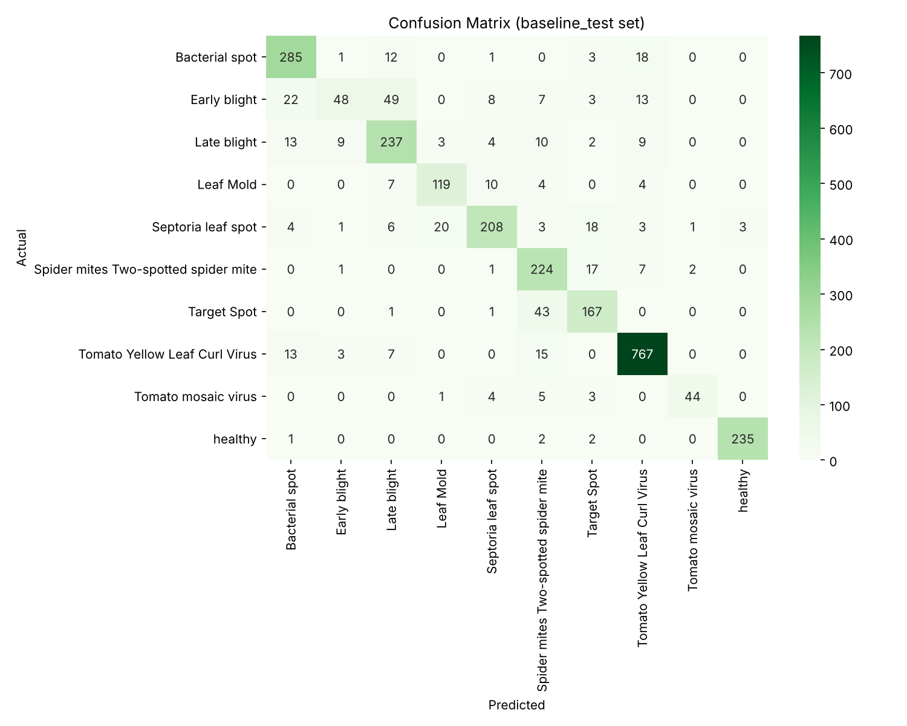

The from-scratch CNN fails on exactly the classes transfer learning
handles: it gets only 48 of 150 early-blight leaves right (sending 49
to late blight), and confuses target spot with spider mites 43 times.

### 5.4 Is the test set leaking? (leaf-grouped split)

PlantVillage photographs each leaf about 4 times. A random image-level
split therefore puts ~97% of test images on a leaf that also has a
photo in training, which could inflate the score. So we retrained with
`train.py --split leaf`, where every photo of a leaf goes to the same
side:

| Split | MobileNetV2 test acc. | Baseline test acc. |
|-------|----------------------:|-------------------:|
| Random, by image (main run) | 91.33% | 85.37% |
| **Grouped by leaf** (no leaf on both sides) | **91.96%** | 83.73% |

**The same within noise, so the overlap was not inflating the result.**
Charts from that run:

| Training curves | Confusion matrix |
|---|---|
| 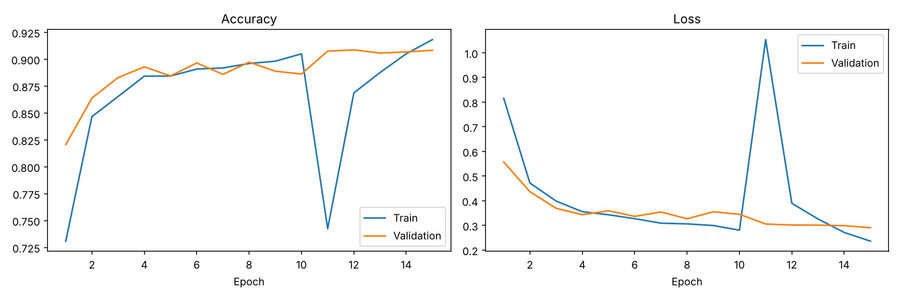 | 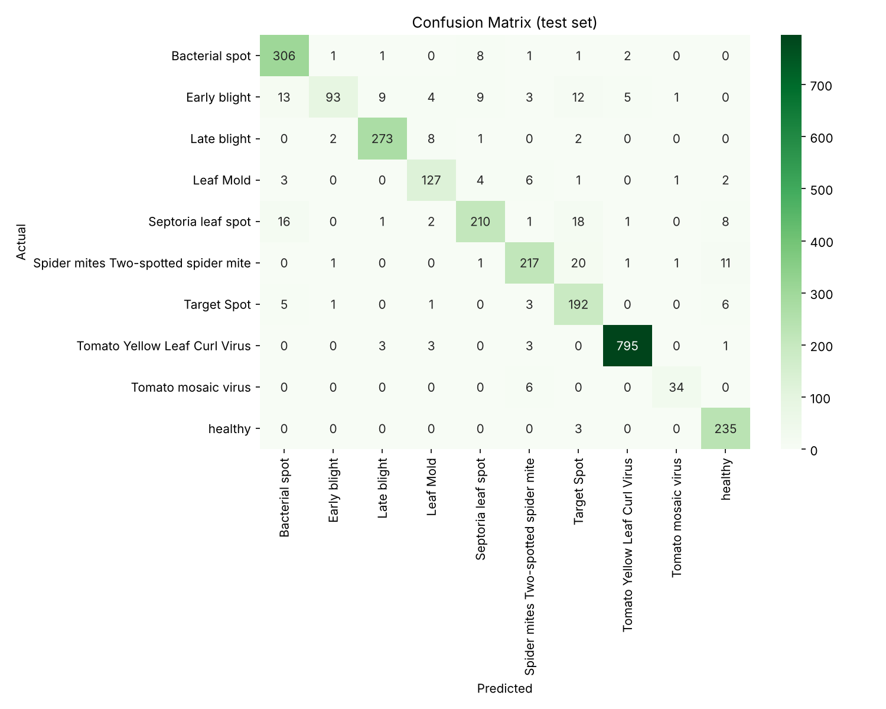 |

Baseline confusion matrix on the leaf split:
[`outputs_leaf_split/confusion_matrix_baseline_test.png`](outputs_leaf_split/confusion_matrix_baseline_test.png).

### 5.5 Predictions on test leaves the model never saw

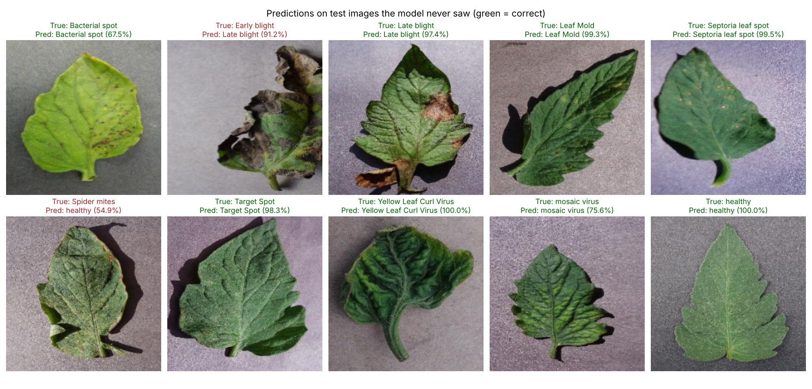

18 of the 20 leaves in `samples/` are classified correctly (all 20, two
per class, are in `outputs/predictions.json`). The two misses are
early blight called late blight (the known weak pair) and a spider-mite
leaf called healthy at only 55%, which the app catches (section 7).

---

## 6. Explainability (Grad-CAM)

Is the model looking at the disease, or at the background? Because the
head is *global average pooling → dense*, the **class activation map is
exact**: weight the 7×7×1280 feature maps by the dense layer's weights
for a class, keep the positive part, upsample to the photo. Red = the
area that pushed the model toward that class. The demo apps draw this
live for every photo.

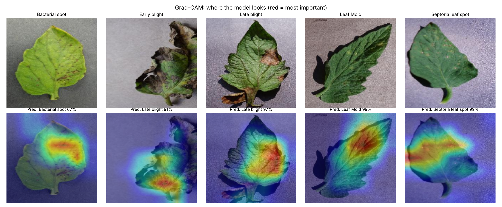

On late blight, the heat sits on the brown lesion. On Septoria, it
covers the spotted area, and on bacterial spot, the speckled patch:
the model has learned disease features, not the background.

**A wrong prediction, explained:**

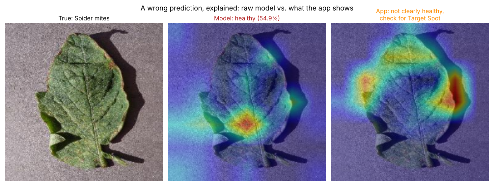

The model calls this spider-mite leaf healthy, but only at 55%, and its
heatmap is weak and scattered. The app doesn't show "Healthy" here.
It shows "not clearly healthy, check for Target Spot", and the third
panel shows where the model sees that disease, along the damaged edge.

> **A lesson from debugging:** the previous wrong example in this
> README, a target-spot leaf called "healthy at 56%", turned out not
> to be the model's fault. The app resized photos with a different
> filter than training did. With the training resize (now shared by
> every inference path through `train.prepare_image`), that leaf is
> Target Spot at 98%. Inference must preprocess exactly like training.

---

## 7. Safety rules

Showing the raw softmax output as-is would be risky. So three rules sit
on top of it. Their thresholds were picked on the **validation** split
and checked once on the test split.

| Rule | Why | Effect on the test set |
|------|-----|------------------------|
| **Say "Healthy" only at ≥ 90%** confidence. Otherwise show the most likely disease as "not clearly healthy" | A sick leaf called healthy is the costliest error: nothing gets treated | Sick leaves called healthy: **56 → 7**. Accuracy 91.4% → **92.8%**. Healthy recall 1.00 → 0.99 (3 of 240 flagged) |
| **Flag answers under 60%** as "not sure" | The model is right only about half the time there | With rule 1: 6.8% of photos flagged; **95.2% accuracy** on the rest |
| **Reject photos that don't look like a tomato leaf** | The model alone was ≥ 60% "sure" of a disease on 27 of 33 non-leaf images (faces, a cat, coffee, text, noise) | Accepts **99.5%** of test leaves; rejected **33/33** non-leaf images |

**How the leaf check works.** Softmax always spreads 100% over the 10
classes it knows, so it can't say "none of these". Instead, compare the
photo's 1280-number feature vector with the average vector of each
class in the training set (cosine similarity). Real tomato leaves land
close to one of them; a face or a coffee cup lands far from all ten.
The cut-off (0.569) is the similarity that 99.5% of validation leaves
score above. Built by `deploy/build_leaf_check.py` into
`outputs/leaf_check.json`.

| Not clearly healthy | Not a leaf | On a phone |
|---|---|---|
|  | 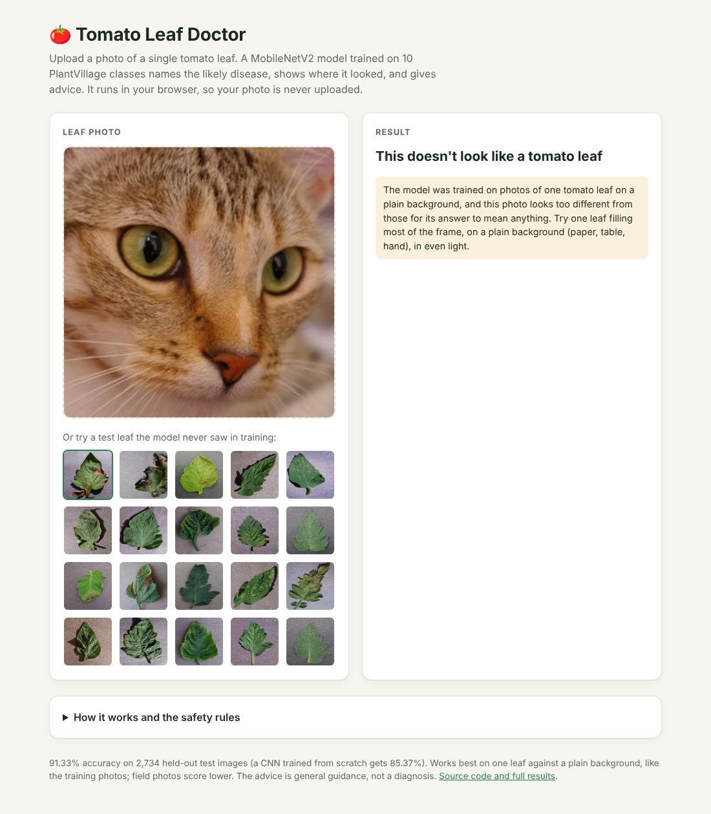 | 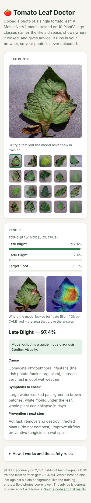 |

---

## 8. The demo apps

### 8.1 Live website (Hugging Face Space, free)

**[huggingface.co/spaces/ashwaanthh/tomato-leaf-doctor](https://huggingface.co/spaces/ashwaanthh/tomato-leaf-doctor)**

- Upload or take a photo, or tap one of 20 test leaves.
- Top-3 predictions, Grad-CAM heatmap, verdict after the safety rules,
  and an info card: cause, symptoms to check, prevention / next step.
- Runs entirely in the browser (ONNX Runtime Web, 9 MB model): fast,
  works offline once loaded, photos never leave the device.
- A "How it works and the safety rules" section explains the model.

### 8.2 Gradio app (`app.py`)

The same features with three tabs: *Diagnose*, *How it works* (results
and figures) and *Limitations*. Run it locally with `python app.py`
(→ http://127.0.0.1:7860), or in Colab with `%run app.py`, which
prints a public share link.

| Diagnose | How it works |
|---|---|
| 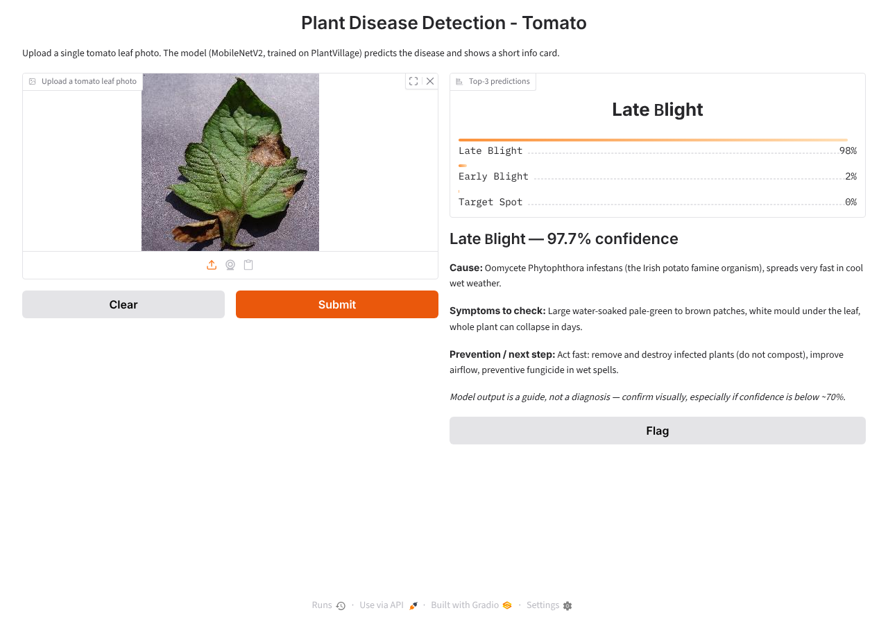 | 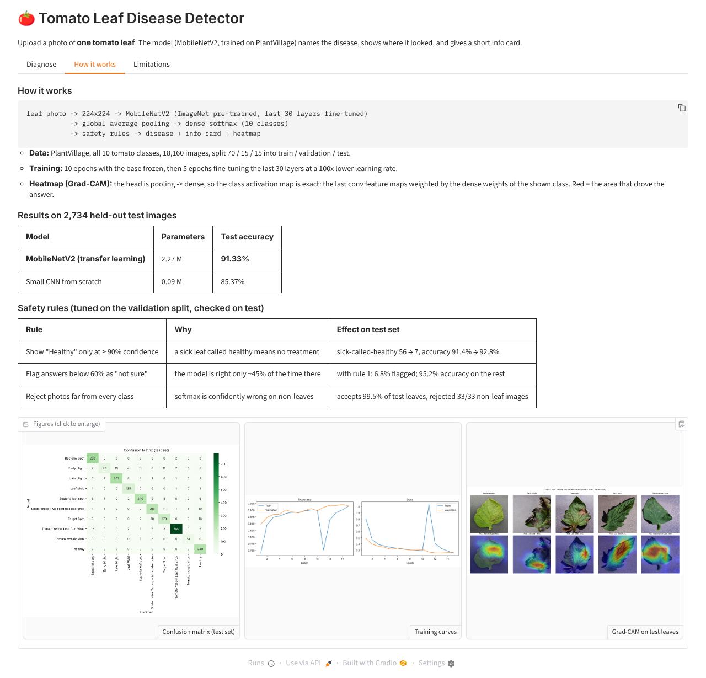 |

More screenshots: [`app_demo_not_healthy_spider_mites_1.png`](outputs/app_demo_not_healthy_spider_mites_1.png),
[`app_demo_not_a_leaf.png`](outputs/app_demo_not_a_leaf.png).

### 8.3 Updating the live Space

1. Free account at https://huggingface.co/join, and a token with
   **Write** access: https://huggingface.co/settings/tokens
2. In this repo folder:
   ```bash
   pip install huggingface_hub
   python deploy/deploy_to_hf.py --space ashwaanthh/tomato-leaf-doctor --static
   ```
   Paste the token when asked. It uploads ~10 MB (the page, ONNX model,
   rules, info cards, 20 sample leaves) and the Space is live in
   seconds. Add `--dry-run` to see the file list first.
3. **After retraining**, rebuild the leaf check and the browser model
   first:
   ```bash
   python deploy/build_leaf_check.py --data-root /path/to/plantvillage
   pip install tf2onnx onnx onnxruntime
   python deploy/export_onnx.py     # checks ONNX against Keras on every sample
   ```

With a Hugging Face PRO account you can drop `--static` to deploy the
Gradio app instead.

---

## 9. Quickstart

### See the results without training (2 minutes)
[](https://colab.research.google.com/github/rabbive/plant-disease-detection/blob/main/plant_disease_results.ipynb)

`plant_disease_results.ipynb` loads the trained model from `outputs/`
and shows the charts, live predictions on `samples/`, Grad-CAM, an
upload-your-own-photo cell and the web app with a public link. It runs
on a normal Colab CPU, and no Kaggle token is needed.

### Train it yourself in Google Colab (free GPU)
1. Open `plant_disease.ipynb` in Colab.
2. Runtime → Change runtime type → **GPU**.
3. Run all cells. The dataset downloads via `kagglehub`, which needs a
   free Kaggle account/API token once.

### Train it yourself locally
```bash
pip install -r requirements.txt
# PlantVillage: e.g. git clone https://github.com/spMohanty/PlantVillage-Dataset (raw/color)
python train.py --data-root /path/to/plantvillage             # main model
python train.py --data-root /path/to/plantvillage --baseline  # + baseline CNN
python train.py --data-root /path/to/plantvillage --split leaf  # leaf-grouped check
python predict.py some_leaf.jpg       # top-3 for one photo
python gradcam.py some_leaf.jpg       # heatmap overlay for one photo
python figures.py                     # redraw prediction / Grad-CAM figures
python app.py                         # Gradio demo
```

If the `.keras` file fails to load on a different Keras version, the
code rebuilds the network and loads `plant_disease_subset.weights.h5`
instead, which gives the same predictions.

---

## 10. Repo structure and output files

```
.
├── plant_disease.ipynb          # Colab: full training pipeline + experiments
├── plant_disease_results.ipynb  # Colab: results + live demo, no training
├── train.py                     # training (MobileNetV2, --baseline, --split leaf) + shared preprocessing
├── predict.py                   # top-3 prediction for one photo
├── gradcam.py                   # Grad-CAM: forward pass, CAM, overlay
├── figures.py                   # redraws the prediction / Grad-CAM figures
├── app.py                       # Gradio demo: info cards, live Grad-CAM, safety rules
├── outputs/                     # reference run: model, charts, reports, logs, leaf check
├── outputs_leaf_split/          # leaf-grouped split run: reports + charts
├── samples/                     # 20 test-split leaves (2 per class) for the demos
├── splits/                      # PlantVillage leaf map for --split leaf
├── deploy/
│   ├── static/                  # the live Space: index.html, model.onnx, rules.json, classes.json
│   ├── deploy_to_hf.py          # upload to Hugging Face (--static for the free Space)
│   ├── export_onnx.py           # Keras → ONNX for the browser, verified against Keras
│   └── build_leaf_check.py      # class-average features for the "is it a leaf?" check
└── docs/                        # demo script, DA stage plan, upgrades, report outline
```

| File | What it is |
|------|------------|
| `outputs/plant_disease_subset.keras` | Trained model |
| `outputs/plant_disease_subset.weights.h5` | Same weights, loadable on older Keras |
| `outputs/class_names.json` | Label order of the model's outputs |
| `outputs/results_summary.json` | Validation + test accuracy, model comparison |
| `outputs/classification_report_test.txt` | Per-class precision / recall / F1 (MobileNetV2) |
| `outputs/classification_report_baseline_test.txt` | Same for the baseline CNN |
| `outputs/leaf_check.json` | Class-average features + cut-off for the leaf check |
| `outputs/predictions.json` | Top-3 and the app's verdict for all 20 samples |
| `outputs/train_log.txt` | Cleaned training log (per-epoch accuracy / loss) |
| `outputs/class_distribution.png` | Images per class and split |
| `outputs/dataset_samples.png` | One training image per class |
| `outputs/training_curves.png` | Accuracy / loss per epoch |
| `outputs/confusion_matrix_test.png` | MobileNetV2 confusion matrix (test) |
| `outputs/confusion_matrix_baseline_test.png` | Baseline CNN confusion matrix (test) |
| `outputs/sample_predictions.png` | Predictions on 10 test leaves |
| `outputs/gradcam_grid.png` | Grad-CAM on 5 test leaves |
| `outputs/gradcam_wrong.png` | A wrong prediction: model vs. app, with heatmaps |
| `outputs/space_demo_*.png`, `outputs/app_demo_*.png` | Screenshots of the live Space and the Gradio app |

---

## 11. Limitations

- **Lab photos.** PlantVillage leaves are photographed alone on plain
  backgrounds. Real field photos (soil, many leaves, shadows, hands)
  will score lower, and a very cluttered photo of a real leaf may be
  rejected by the leaf check. Testing on field photos is the next step.
- **Tomato only, 10 classes.** A disease outside this list gets mapped
  to the closest one it knows (unless the leaf check rejects it).
- **Weakest class:** early blight (recall 0.62), confused with the
  other brown-spot diseases.
- **The info cards are general guidance** summarised from agriculture
  extension sources, not a diagnosis or a treatment prescription.

---

## 12. Credits

- **Dataset:** PlantVillage — Hughes & Salathé; Mohanty, Hughes &
  Salathé (2016), *Using Deep Learning for Image-Based Plant Disease
  Detection*. Images from
  [spMohanty/PlantVillage-Dataset](https://github.com/spMohanty/PlantVillage-Dataset)
  (`raw/color`); the Colab notebook can also use the Kaggle copy
  "New Plant Diseases Dataset (Augmented)".
- **Starting reference:** the student project
  [RayanAIX/Plant-Disease-Detection](https://github.com/RayanAIX/Plant-Disease-Detection),
  rebuilt here with a real trained model, test split, baseline
  comparison, Grad-CAM, safety rules and a working demo.
- **Frameworks:** TensorFlow / Keras, MobileNetV2 (ImageNet weights),
  Gradio, ONNX Runtime Web.

## License

MIT — see [LICENSE](LICENSE).
