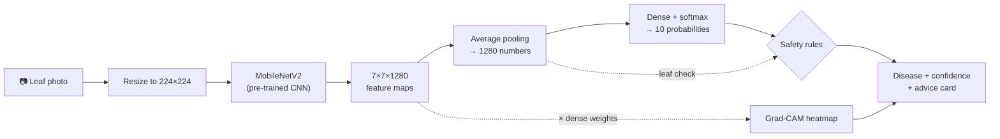
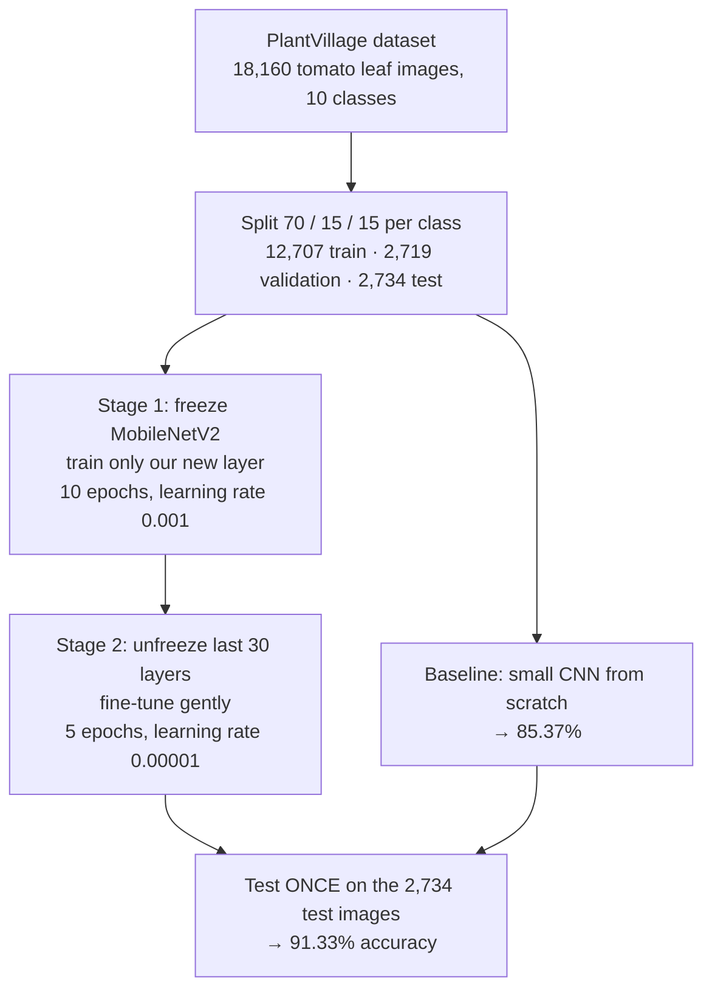
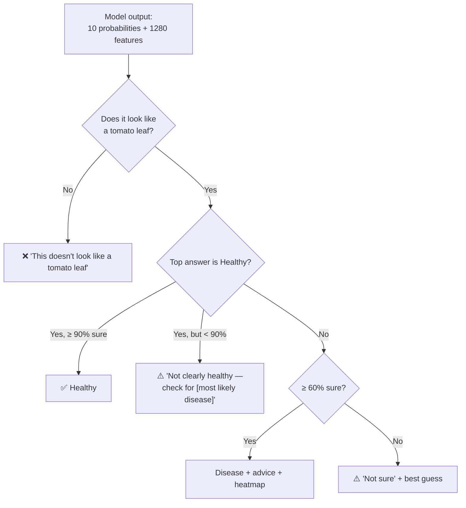
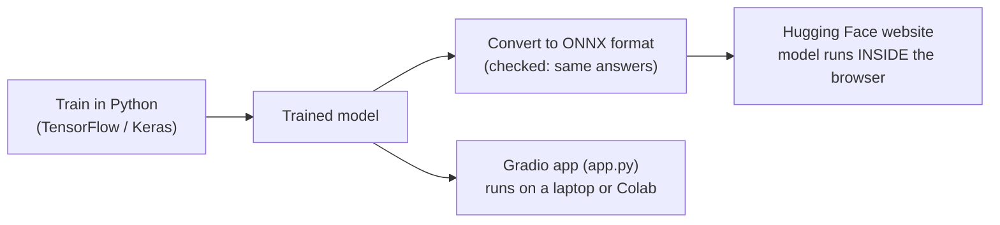

# Tomato Leaf Doctor: How It Works (Presentation Guide)

Live demo: **https://huggingface.co/spaces/ashwaanthh/tomato-leaf-doctor**
Code + charts: **https://github.com/rabbive/plant-disease-detection**

---

## The 30-second version (say this first)

> "Farmers lose tomato crops to leaf diseases, and spotting them early
> needs an expert. Our system takes **one photo of a tomato leaf** and,
> in about a second, says **which of 10 conditions** it has (9 diseases
> or healthy), **shows where it looked** on the leaf, and gives
> **advice**. We used **transfer learning with MobileNetV2**, trained on
> 18,160 PlantVillage images, and it gets **91.33% accuracy on 2,734
> test images it never saw**. On top of the model we added **three
> safety rules** so it doesn't call sick leaves healthy and doesn't
> diagnose photos that aren't leaves. It runs live on any phone."

---

## Flowchart 1: From photo to advice (the big picture)

**How to explain it, box by box:**

1. **Leaf photo.** The user uploads or takes a photo of one leaf.
2. **Resize to 224×224.** The network only accepts 224×224-pixel
   images, so every photo is shrunk to that size. *Important detail:*
   we resize **exactly the same way as during training** (bilinear).
   We found a bug where the app resized differently, and it changed
   some answers by up to 35%.
3. **MobileNetV2.** A convolutional neural network (CNN) already
   trained on 1.2 million everyday photos (ImageNet). It already knows
   how to detect edges, textures, spots and shapes. We **reuse** that
   knowledge instead of starting from zero. That's **transfer
   learning**.
4. **7×7×1280 feature maps.** The CNN's output: the image divided into
   a 7×7 grid, and for each grid cell, 1,280 numbers describing what's
   there ("brown spot", "yellow edge", "vein pattern", ...).
5. **Average pooling → 1280 numbers.** Average over the 7×7 grid, so
   the whole leaf is summarised as one list of 1,280 numbers.
6. **Dense + softmax → 10 probabilities.** Our own layer (the only
   part we trained from scratch) turns the 1,280 numbers into 10
   probabilities that add up to 100%, one per class.
7. **Safety rules.** Decide what to actually show the user
   (Flowchart 3).
8. **Grad-CAM heatmap.** Shows **where on the leaf** the model looked
   (red = most important). Explained in section 5 below.
9. **Result.** Disease name, confidence, heatmap, and an advice card
   (cause, symptoms, prevention).

---

## Flowchart 2: How we trained it

**How to explain it:**

- **Dataset:** PlantVillage, all 10 tomato classes. The photos are
  single leaves on plain backgrounds, taken in a lab.
- **Three splits, three jobs:**
  - **Train (70%)**: the model learns from these.
  - **Validation (15%)**: used to make choices (number of epochs,
    safety thresholds).
  - **Test (15%)**: touched **only once, at the end**. That's the
    honest score, on images the model never saw in any form.
- **Why two stages?**
  - *Stage 1:* our new layer starts random. If we trained everything
    at once, its random errors would damage MobileNetV2's good
    pre-trained weights. So we **freeze** MobileNetV2 and train only
    the new layer first.
  - *Stage 2:* once the new layer is decent, we **unfreeze the last 30
    layers** and train with a **100× smaller learning rate**, so they
    adapt to leaves without forgetting what they know.
- **Baseline comparison:** a small CNN trained from scratch on the same
  data gets **85.37%**. MobileNetV2 gets **91.33%**. That **6-point
  gap is what transfer learning buys us**.

**If they point at the training-curves chart:**
validation accuracy goes 84.7% → 89.7% (stage 1) → 91.4% (stage 2).
The **dip at epoch 11** is exactly when we unfreeze the 30 layers in
stage 2: training accuracy drops for one epoch, then recovers.
Validation keeps rising.

---

## Flowchart 3: The safety rules (how the app decides what to show)

**Why we need rules at all:** a neural network **always** gives an
answer, even for a photo of a cat. And some mistakes are worse than
others.

**Rule 1: Is it a tomato leaf?**
- *Problem:* the model was 60% or more "sure" of a disease for **27 of
  33 non-leaf photos** (faces, a cat, coffee). Softmax always spreads
  100% across the 10 classes it knows. It can't say "none of these".
- *Solution:* compare the photo's 1,280 numbers with the **average**
  1,280 numbers of each class from training (cosine similarity). Real
  tomato leaves are close to one of those averages; a cat is far from
  all ten.
- *Result:* accepts **99.5%** of real test leaves and rejected **33/33**
  non-leaf photos.

**Rule 2: Only say "Healthy" at 90% or more**
- *Problem:* the costliest mistake is calling a **sick** leaf
  **healthy**, because then the farmer does nothing. Before the rule,
  56 sick test leaves were called healthy.
- *Solution:* if the model says "Healthy" with less than 90%
  confidence, show the most likely disease instead and ask the user to
  check.
- *Result:* sick-called-healthy dropped from **56 to 7**, and overall
  accuracy went **up**, from 91.4% to **92.8%**.

**Rule 3: Flag answers under 60% as "not sure"**
- *Why:* when the model is under 60% sure, it's right only about half
  the time.
- *Result:* 6.8% of photos get flagged, and accuracy on the rest is
  **95.2%**.

**Key point to say:** all thresholds (90%, 60%, the leaf cut-off) were
chosen on the **validation** set, never the test set. The test set was
only used to report the result.

---

## Grad-CAM: how the heatmap works

**Question it answers:** "Is the model looking at the disease, or at
the background?"

**How it works, in plain words:**
1. Take the **7×7 grid of features** (box 4 in Flowchart 1).
2. Our final layer has learned how much each of the 1,280 features
   matters for each disease.
3. For each of the 49 grid cells, add up its features weighted by that
   importance. That gives a 7×7 "importance map".
4. Stretch it to the photo's size and colour it: **red = important,
   blue = ignored**.

**What it shows:** on late blight, the red sits on the brown lesion. On
Septoria, it's on the spots. So **the model learned real disease
features**, not the background.

**The wrong-prediction example (chart `gradcam_wrong.png`):** a
spider-mite leaf the model calls "healthy" at only 55%. Its heatmap is
weak and scattered, showing the model isn't confident. Rule 2 catches
it, and the app shows "not clearly healthy, check for Target Spot".

---

## Flowchart 4: How the live website works

**How to explain it:**
- We trained in Python, then **converted the model to ONNX**, a
  standard format that can run inside a web browser.
- The website (Hugging Face Space) downloads the 9 MB model once and
  **runs it on the user's own phone or laptop**. The photo is **never
  uploaded**, which protects privacy and needs no server.
- We checked that the browser version gives **exactly the same
  answers** as the Python version, on all 20 sample leaves.

---

## Results to quote

| What | Number |
|------|--------|
| Test accuracy (MobileNetV2) | **91.33%** |
| Small CNN from scratch (baseline) | 85.37% |
| Accuracy with the safety rules | **92.8%** |
| Sick leaves called healthy | 56 → **7** |
| Non-leaf photos rejected | **33 / 33** |
| Best class | Yellow Leaf Curl Virus (F1 0.98) |
| Weakest class | Early blight (recall 0.62): confused with other brown-spot diseases |
| Model size | 2.27 M parameters, 9 MB |

---

## Likely questions and short answers

**Why MobileNetV2?**
It's small (2.3 M parameters) and fast enough to run on a phone, and it
was pre-trained on ImageNet, so it already understands images.

**What is transfer learning?**
Reusing a network trained on one big task (ImageNet) for a new task
(tomato leaves). We keep its learned features and only train a new
final layer, then fine-tune the top layers.

**Why is early blight the weakest?**
It looks like other brown-spot diseases (target spot, Septoria, late
blight) and has fewer training images (1,000 vs 5,357 for the biggest
class).

**Isn't the test set leaking?** (PlantVillage has ~4 photos per leaf)
We checked: we retrained with a split where all photos of a leaf go to
the same side. We got **91.96%**, the same as 91.33% within noise, so
there's no leak.

**How did you choose 90% and 60%?**
On the validation set only. The test set was used once, to report the
effect.

**Why not just use the confidence to reject non-leaves?**
Softmax always adds up to 100% over the 10 known classes, so it's often
very "confident" on random photos (27 of 33 at 60% or more). Distance
in feature space doesn't have that problem.

**Would it work on real field photos?**
It will score lower. The training photos are single leaves on plain
backgrounds. That's our main limitation, and testing on field photos
is the next step.

**What would you improve next?**
Field photos for testing and training, more images for the small
classes (mosaic virus, early blight), and more crops.

---

## Demo order (2 minutes)

1. Open the live site and click a **late blight** sample: "97%, red on
   the lesion, advice card."
2. Click **spider_mites_1**: "The model leans Healthy at 55%, but our
   rule says that's not enough, so it says *not clearly healthy*."
3. Click **early_blight_1**: "Honest mistake: it says late blight.
   They look alike; it's our weakest class."
4. **Upload any non-leaf photo** (or ask the professor to take one):
   "It refuses instead of making up a diagnosis."
5. Open **"How it works and the safety rules"** under the app to show
   the rules table.
